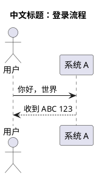

# 图表与 UML：Graphviz + PlantUML

本机装的是 **PlantUML 1.2026.9**（`plantuml -version` 的输出就是版本依据）、
**Graphviz 16.1.0**（`dot -V`），Java 用底座的 **openjdk-21 21.0.12**。
没有图形界面，全部命令行非交互。

## 运行链路

```
plantuml（本组件，$PREFIX/bin/plantuml）
  └─ java -jar $PREFIX/share/java/plantuml.jar
       ├─ Java 运行时        ← 底座 openjdk-21（21.0.12）
       ├─ AWT 字体本地库     ← 本组件额外带的 openjdk-21-x（libfontmanager.so）
       │     └─ 缺了会直接报 UnsatisfiedLinkError: no fontmanager，PlantUML 起不来
       ├─ 类图等布局         ← 外部 dot（Graphviz；本组件 roots 里有，底座已有时不重复装）
       └─ 字体               ← fontconfig：/system/fonts 与 $PREFIX/share/fonts
dot（Graphviz 16.1.0；devkit-2026.10.18 底座自带）
  └─ 字体 → fontconfig（/system/fonts 与 $PREFIX/share/fonts）
```

| 这一环 | 由谁提供 | 在哪 | 缺了会怎样 |
|---|---|---|---|
| `plantuml` 命令 | 本组件：Termux 包 `plantuml` 1.2026.9 | `$PREFIX/bin/plantuml` | 命令不存在 |
| `plantuml.jar` | 本组件 | `$PREFIX/share/java/plantuml.jar` | `plantuml` 报找不到 jar |
| `java` | 底座：Termux 包 `openjdk-21` | `$PREFIX/bin/java` | 命令不存在 |
| `libfontmanager.so` 等 AWT 库 | 本组件：Termux 包 `openjdk-21-x` | `$PREFIX/lib/jvm/java-21-openjdk/lib/` | **明确报错** `no fontmanager in system library path`，PlantUML 完全不可用 |
| `dot` | 底座：Graphviz 16.1.0（旧底座由本组件带） | `$PREFIX/bin/dot` | Graphviz 命令不可用；PlantUML 的类图等依赖 dot 的图类型会失败 |
| 中文字体 | 系统 `/system/fonts` | `/system/fonts/NotoSansCJK-Regular.ttc` | 中文变方块，**不报错**；没有 CJK 字体时只能显示英文 |

`openjdk-21-x` 只补 AWT 的本地库和 freetype/X11 依赖（约 12 MB 下载），不会换掉底座的 JDK。

## 先自检

```sh
diagrams-selftest
```

它会用 Graphviz 生成一张 SVG + PNG，再用 PlantUML 生成一张时序图 SVG，核对文件里确实有节点文字。
最后一行应是 `===== 总结 ===== graphviz=OK plantuml=OK fonts=CJK`（CI 无系统字体时是 `fonts=ASCII`）。
不联网，只写 `$TMPDIR`，两三秒结束。

## Graphviz（.dot → 图片）

```sh
dot -Tsvg flow.dot -o flow.svg
dot -Tpng flow.dot -o flow.png
dot -Gdpi=200 -Tpng flow.dot -o flow-200.png    # 提高分辨率
dot -V                                           # graphviz version 16.1.0
```

本机实测的 `flow.dot`：


- SVG 里直接包含 `中文测试` 等文字；PNG 用 OCR 回读也识别出中文，**不是方块**。
- 中文走 fontconfig，默认 `fontname` 就能找到 Noto CJK；也可以显式写
  `node [fontname="Noto Sans CJK SC"]`，两种写法都实测正常。
- 真实设备上 `/system/fonts` 由系统提供；CI / 无系统字体的环境只有 DejaVu，中文会变方框，属于环境限制。

## PlantUML（.puml → 图片）

```sh
plantuml -tsvg seq.puml        # 生成 seq.svg（和输入同目录、同基名）
plantuml -tpng seq.puml        # 生成 seq.png
plantuml -version              # PlantUML version 1.2026.9
```

本机实测的时序图：



- SVG 里能搜到 `中文标题：登录流程`、`你好，世界`、`收到 ABC 123`；PNG 用 OCR 回读也识别出中文。
- 类图同样实测过（`class 用户 { +名字: String }` 之类），SVG 正常。
- **JVM 冷启动约 2.4–2.7 秒/次**，峰值内存约 240 MB。PlantUML 不做常驻服务，每敲一次命令起一个新 JVM；
  图多时一次传多个文件（`plantuml -tsvg a.puml b.puml`）比逐张跑省时间。
- 类图等布局会调用外部 `dot`：`plantuml -v -tsvg class.puml` 的输出里能看到
  `Starting Graphviz process […/bin/dot, -Tsvg]`。所以 Graphviz 不在时会明确失败，不是悄悄降级。
- 输出文件写在输入文件旁边；目录不可写时会打出 `java.io.FileNotFoundException`（**退出码可能仍是 0**），
  所以看完命令要确认目标文件真的生成了。先把 .puml 放到可写目录（例如 `$TMPDIR`）。

## 中文与字体

- Graphviz 与 PlantUML 都通过 fontconfig 找字体，配置里已经包含 `/system/fonts` 和 `$PREFIX/share/fonts`。
- 真机上 `fc-list` 不一定装了，但字体查找本身由库完成，不需要命令行工具；实测中文能正常渲染。
- 如果中文全是方块：确认设备上存在 `/system/fonts/NotoSansCJK-Regular.ttc`；没有的话装一个带中文字体的系统
  （组件不带字体，避免体积和许可问题）。
- PlantUML 报 `no fontmanager in system library path` 不是字体问题，是 `openjdk-21-x` 没装上：
  重装本组件，或检查 `$PREFIX/lib/jvm/java-21-openjdk/lib/libfontmanager.so` 是否存在。

## 和 typst / Mermaid 的分工

- **简单流程图、架构草图、文档里的插图**优先用底座自带的 **typst**（0.15.1）：秒出、不联网、中文直接可用。
- 需要自动布局、大量节点、或用户已经给了 `.dot` → 用 Graphviz `dot`。
- 需要 UML（时序图、类图、用例图）或用户已经给了 `.puml` → 用 PlantUML。
- 本组件**不含 Mermaid**：mermaid-cli 要无头浏览器，组件里没有带；用户要 Mermaid 时先跟用户说明这一点，
  不要假装能跑。

## 常见坑

| 现象 | 原因 / 处理 |
|---|---|
| `UnsatisfiedLinkError: no fontmanager in system library path` | `openjdk-21-x` 缺失（组件没装全）；重装本组件 |
| 中文全变方块 | fontconfig 看不到 CJK 字体；检查 `/system/fonts/NotoSansCJK-Regular.ttc` |
| PlantUML 每一张图都要等两三秒 | 每次调用都新起 JVM，属正常；多图合并成一次调用 |
| 类图报找不到 dot / 图出不来 | Graphviz 不在 PATH；本组件已带 `dot`，重装组件或检查 `$PREFIX/bin/dot` |
| `plantuml` 报找不到 jar | `$PREFIX/share/java/plantuml.jar` 缺失；重装组件 |
| 输出的图片跑到别处 | PlantUML 默认写在输入文件同目录；把输入放到可写目录 |
| 目录不可写但退出码是 0 | PlantUML 只打 `FileNotFoundException` 堆栈、不返回非 0；检查目标文件是否生成 |
